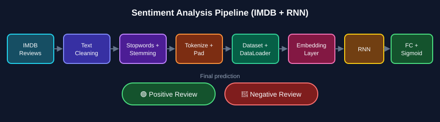
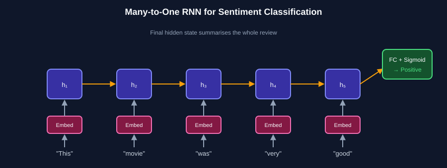
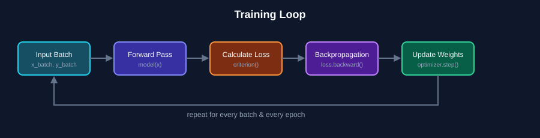
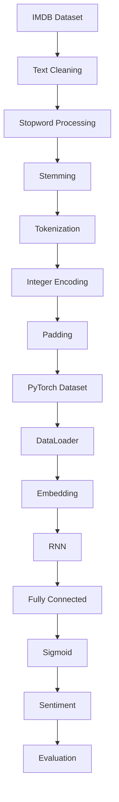

<h1 align="center">🧠 Deep Learning — Part 6</h1>
<h2 align="center">🎬 Sentiment Analysis using RNN</h2>

<p align="center">
  
  
  
  
  
</p>

<p align="center">
  A practical deep-learning project for <b>binary sentiment classification</b> using the
  <b>IMDB Movie Reviews Dataset</b> and a <b>Recurrent Neural Network (RNN)</b> built with PyTorch.
</p>

<p align="center">
  <b>Text Cleaning → Tokenization → Sequence Processing → Embedding → RNN → Training → Evaluation → Prediction</b>
</p>



---

## 📑 Table of Contents

1. [About This Module](#-about-this-module)
2. [Dataset](#-dataset)
3. [Problem Definition](#1️⃣-problem-definition)
4. [Text Preprocessing](#2️⃣-text-preprocessing)
5. [Stopword Removal](#3️⃣-stopword-removal)
6. [Stemming](#4️⃣-stemming)
7. [Text → Numbers](#5️⃣-text--numbers)
8. [Dataset & DataLoader](#6️⃣-dataset--dataloader)
9. [RNN Architecture](#7️⃣-rnn-architecture)
10. [Training the Model](#8️⃣-training-the-model)
11. [Model Evaluation](#9️⃣-model-evaluation)
12. [Sentiment Prediction](#-sentiment-prediction)
13. [Project Architecture](#-complete-project-architecture)
14. [Technologies](#️-technologies--libraries)
15. [What I Learned](#-what-i-learned)
16. [Future Improvements](#-future-improvements)

---

## 📌 About This Module

This module builds an end-to-end **Natural Language Processing (NLP)** pipeline for sentiment analysis. The model learns from movie reviews and predicts whether a review expresses a:

- 🟢 **Positive** sentiment
- 🔴 **Negative** sentiment

The project combines classical NLP preprocessing with a deep-learning workflow in **PyTorch**.

---

## 📊 Dataset

### IMDB Dataset of 50K Movie Reviews

| Column | Description |
|---|---|
| `review` | Movie review text |
| `sentiment` | `positive` or `negative` |

| Review | Sentiment |
|---|---|
| *"Watching Oz, you may become comfortable..."* | 🟢 positive |
| *"Some meaningless thriller spots..."* | 🔴 negative |

> ⚠️ The dataset is **not included** in this repository because of GitHub file-size limitations.

### 📥 Download

Download **IMDB Dataset of 50K Movie Reviews** from Kaggle, then place `IMDB Dataset.csv` inside `Lecture Dataset/`:

```text
44. Deep Learning (Part 6)/
│
├── Lecture Dataset/
│   └── IMDB Dataset.csv
│
├── RNN Code/
│   └── ...
│
└── README.md
```

---

## 1️⃣ Problem Definition

**Supervised Learning → Binary Text Classification**

| Input Review | Predicted Sentiment |
|---|---|
| *"This movie was absolutely fantastic!"* | 🟢 Positive |
| *"This film was boring and terrible."* | 🔴 Negative |

---

## 2️⃣ Text Preprocessing

Raw text can't be fed directly to a neural network — it must be cleaned and converted into numbers.

### 🧹 Regex Cleaning

Typical operations:

- Remove HTML tags
- Remove special characters & punctuation
- Remove numbers
- Remove extra spaces
- Convert to lowercase

| Before | After |
|---|---|
| `I loved this movie!!! <br/>` | `i loved this movie` |

```python
import re

def clean_text(text):
    text = re.sub(r'<.*?>', '', text)        # remove HTML tags
    text = re.sub(r'[^a-zA-Z]', ' ', text)   # keep letters only
    text = text.lower()                       # lowercase
    text = re.sub(r'\s+', ' ', text).strip()  # remove extra spaces
    return text
```

---

## 3️⃣ Stopword Removal

Stopwords are very common words (`the`, `is`, `was`, `are`, `and`, `of`) that contribute little to classification.

```python
from nltk.corpus import stopwords

stop_words = set(stopwords.words("english"))

filtered_words = [word for word in words if word not in stop_words]
```

| Before | After |
|---|---|
| `This movie was really very good` | `movie really good` |

---

## 4️⃣ Stemming

Stemming reduces words to a common root form.

| Word | Stem |
|---|---|
| running | run |
| played | play |
| movies | movi |

```python
from nltk.stem import PorterStemmer

stemmer = PorterStemmer()
stemmed_words = [stemmer.stem(word) for word in words]
```

> 💡 A stem is not always a valid English word — e.g. `movies → movi`.

---

## 5️⃣ Text → Numbers

Neural networks operate on numerical tensors, not raw text.

```text
"This movie was fantastic"   →   [12, 48, 7, 931]
```

These token IDs are passed into an **Embedding Layer**.

```text
Text → Tokenization → Integer Sequence → Padding → Embedding → RNN
```

> 📝 **TF-IDF** is great for traditional ML models (Logistic Regression, Naive Bayes, SVM). For an RNN pipeline the usual route is *token IDs → embeddings*. Treat them as **alternative representations**, not consecutive steps.

---

## 6️⃣ Dataset & DataLoader

PyTorch's `Dataset` and `DataLoader` efficiently prepare and feed training data.

```text
Dataset → DataLoader → Mini-batches → RNN
```

**Why DataLoader?**

- ⚡ Efficient batch processing
- 💾 Better memory usage
- 🔀 Supports shuffling
- 🚀 Works well with GPU training
- 📈 Cleaner training loops

```python
from torch.utils.data import DataLoader

train_loader = DataLoader(train_dataset, batch_size=64, shuffle=True)
```

---

## 7️⃣ RNN Architecture

An RNN processes sequences word by word, carrying a **hidden state** from earlier steps forward.



### PyTorch Model

```python
import torch
import torch.nn as nn

class RNNModel(nn.Module):
    def __init__(self, vocab_size, embedding_dim, hidden_dim):
        super().__init__()

        self.embedding = nn.Embedding(vocab_size, embedding_dim)
        self.rnn = nn.RNN(embedding_dim, hidden_dim, batch_first=True)
        self.fc = nn.Linear(hidden_dim, 1)

    def forward(self, x):
        x = self.embedding(x)
        output, hidden = self.rnn(x)
        out = self.fc(hidden[-1])
        return out
```

| Layer | Purpose |
|---|---|
| `nn.Embedding` | Converts token IDs into dense vectors |
| `nn.RNN` | Processes the sequence & updates the hidden state |
| `nn.Linear` | Maps the final hidden state to one score |
| Sigmoid | Converts the score into a probability (0–1) |

---

## 8️⃣ Training the Model



### Setup

```python
criterion = nn.BCEWithLogitsLoss()               # includes the sigmoid
optimizer = torch.optim.Adam(model.parameters(), lr=0.001)
```

### Complete Training Pattern

```python
for epoch in range(epochs):

    model.train()

    for x_batch, y_batch in train_loader:

        optimizer.zero_grad()              # reset gradients

        output = model(x_batch)            # 1. forward pass

        loss = criterion(output, y_batch)  # 2. calculate loss

        loss.backward()                    # 3. backpropagation

        optimizer.step()                   # 4. update parameters
```

---

## 9️⃣ Model Evaluation

After training, the model is evaluated on **unseen data**.

| Metric | Meaning |
|---|---|
| **Accuracy** | Percentage of correct predictions |
| **Precision** | How many predicted positives are actually positive |
| **Recall** | How many actual positives were identified |
| **F1 Score** | Harmonic mean of precision and recall |

> Example: `Accuracy = 88%` → about 88 out of every 100 predictions are correct.

---

## 🎯 Sentiment Prediction

| Review | Prediction |
|---|---|
| *"This movie was absolutely fantastic!"* | 🟢 **Positive** |
| *"This film was boring and terrible."* | 🔴 **Negative** |

---

## 🧩 Complete Project Architecture



---

## 🛠️ Technologies & Libraries

<p align="center">
  <b>Python</b> • <b>PyTorch</b> • <b>NLTK</b> • <b>Pandas</b> • <b>NumPy</b> • <b>Scikit-learn</b> • <b>Regex</b>
</p>

**Core concepts:** 🐍 Python · 🔥 PyTorch · 🧠 Deep Learning · 🔁 RNN · 💬 NLP · 🧹 Text Preprocessing · 📊 Binary Classification · 📈 Model Evaluation

---

## 📚 What I Learned

**NLP**

- ✅ Regex-based text cleaning
- ✅ Stopword processing
- ✅ Stemming
- ✅ Tokenization
- ✅ Numerical text representation
- ✅ Sequence preparation

**Deep Learning**

- ✅ PyTorch datasets & DataLoaders
- ✅ Embedding layers
- ✅ RNN architecture & hidden states
- ✅ Forward propagation & loss calculation
- ✅ Backpropagation & optimizer-based updates
- ✅ Model evaluation & sentiment prediction

---

## 💡 Key Learning

> **An RNN processes sequential data by carrying information from previous time steps through its hidden state.**

Useful for: 📝 Sentiment Analysis · 💬 Text Classification · 🌐 Language Modeling · 🔤 Sequence Prediction · 📖 Text Generation

### ⚠️ Practical Note

Modern NLP often moves beyond basic RNNs:

```text
RNN  →  LSTM / GRU  →  Transformer  →  BERT / Modern LLMs
```

Still, building an RNN from scratch is a great way to understand sequential processing, hidden states, embeddings, backpropagation through time, and text classification.

---

## 📂 Suggested Repository Structure

```text
44. Deep Learning (Part 6)/
│
├── Lecture Dataset/
│   └── IMDB Dataset.csv
│
├── RNN Code/
│   └── sentiment_analysis_rnn.ipynb
│
├── Handwritten Digit Classification Assignment/
│   └── ...
│
├── Refer for MNIST Dataset/
│   └── ...
│
├── images/
│   ├── sentiment_pipeline.svg
│   ├── rnn_sentiment_model.svg
│   └── training_loop.svg
│
└── README.md
```

> 🔒 Keep large datasets outside Git, or add them to `.gitignore`.

---

## 🚀 Future Improvements

- 🔁 LSTM
- 🔄 GRU
- 🧠 Bidirectional RNN
- 🧹 Improved text normalization
- 📊 Confusion matrix
- 📈 Training / validation curves
- ⚡ GPU acceleration
- 🎯 Hyperparameter tuning
- 🧪 Dropout & regularization
- 🤗 Transformer-based sentiment analysis

---

## 🏁 Final Takeaway

```text
🎬 Movie Reviews → 🧹 Clean Text → 🔤 Process Tokens → 🔢 Sequences
   → 📦 Dataset & DataLoader → 🧠 Embedding → 🔁 RNN
   → 🎯 Classification → 📈 Evaluation → 💬 Sentiment Prediction
```

---

<div align="center">

### 👨‍💻 Made by [Sayan Pal](https://www.linkedin.com/in/sayanpal04?utm_source=share_via&utm_content=profile&utm_medium=member_android)

**AI / ML • Deep Learning • NLP • Python • PyTorch**

⭐ Learning • Building • Experimenting • Improving ⭐

<a href="https://www.linkedin.com/in/sayanpal04?utm_source=share_via&utm_content=profile&utm_medium=member_android">
  
</a>

<i>Part of my AI / ML Deep Learning learning journey.</i>

</div>
