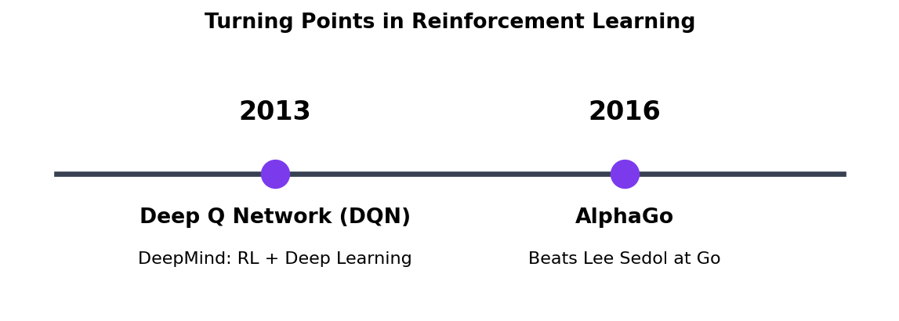
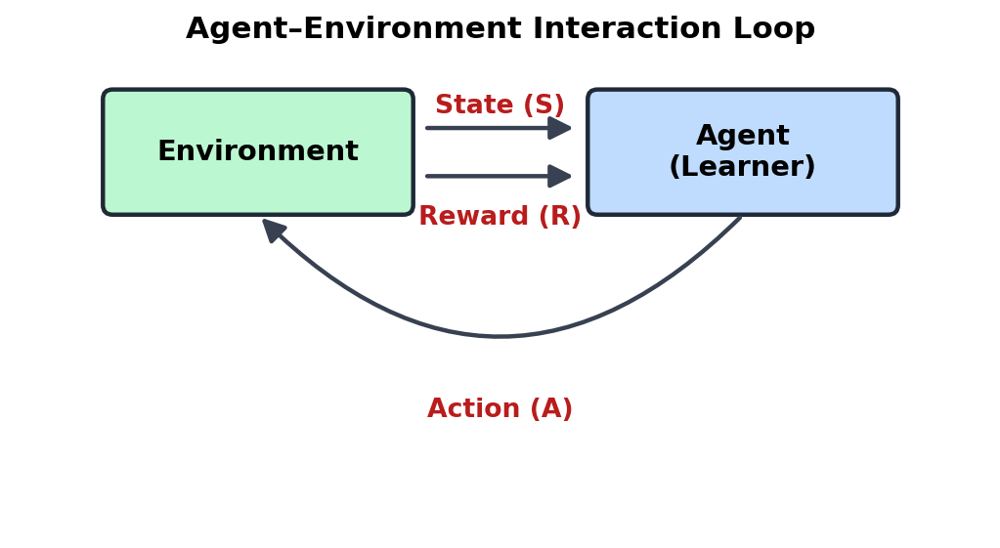
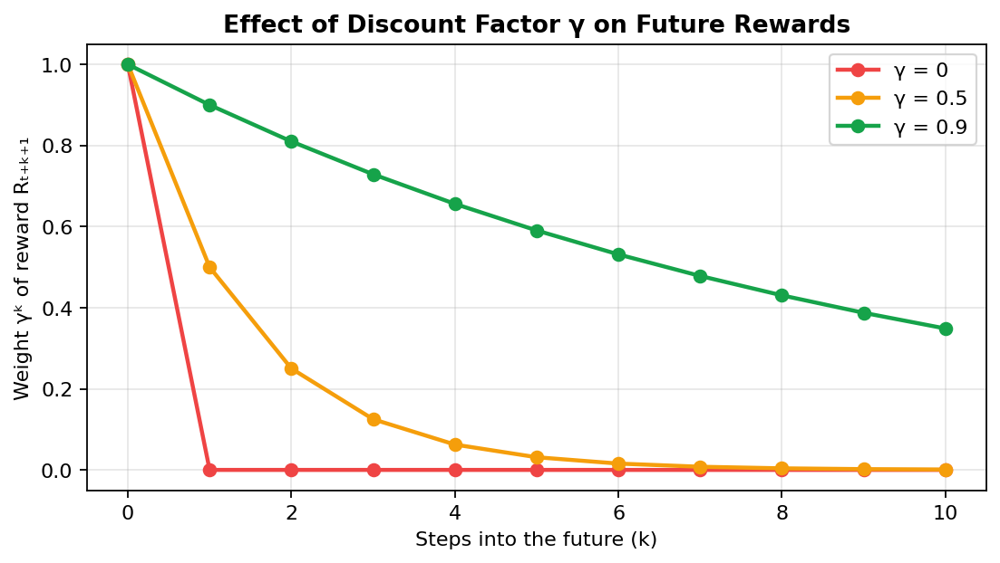
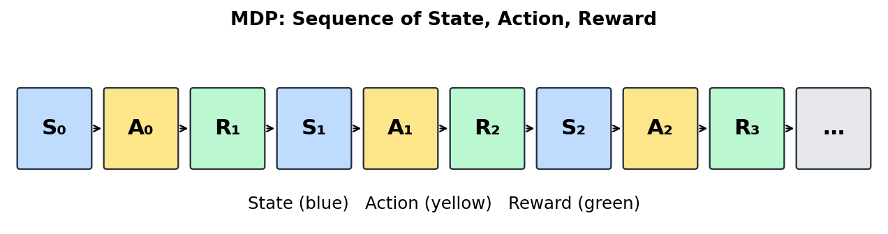
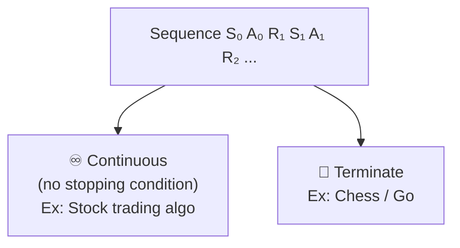
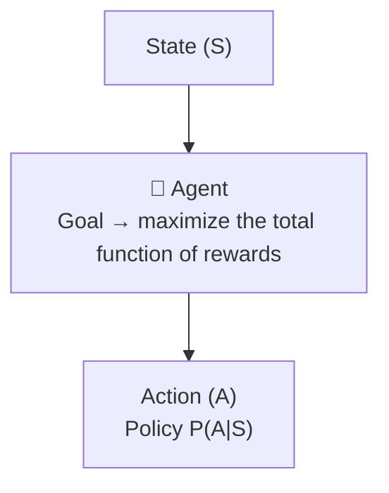
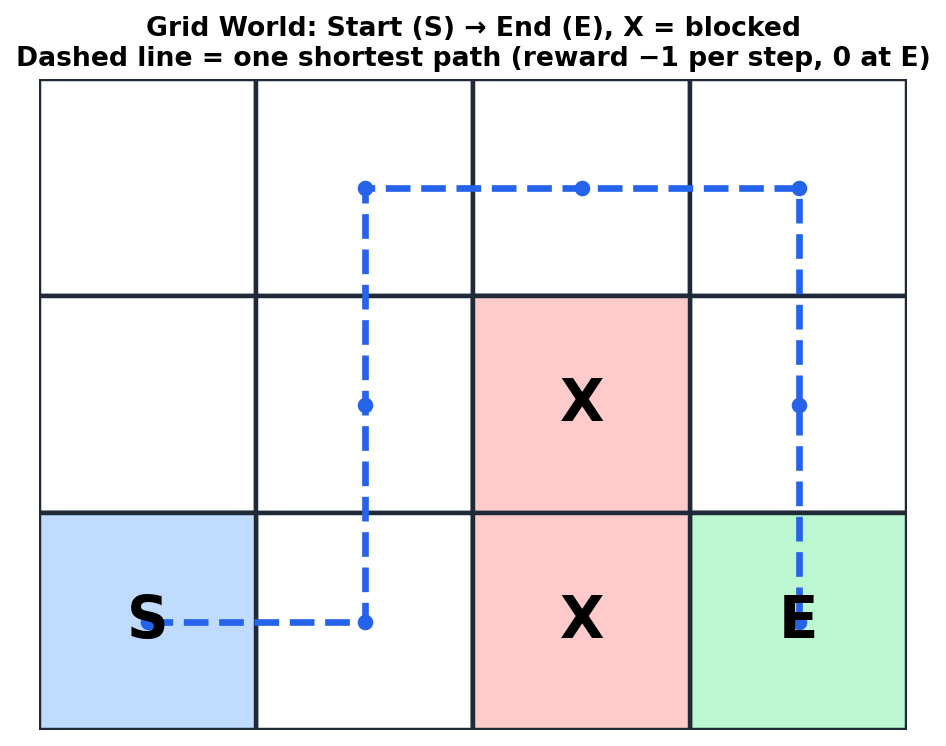
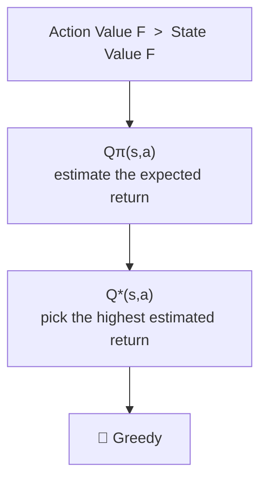
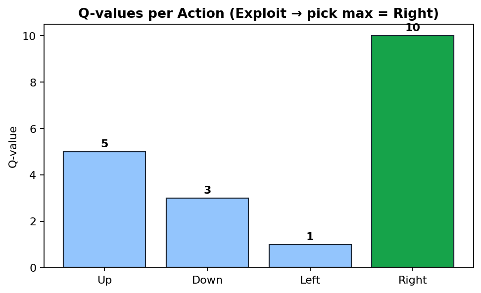
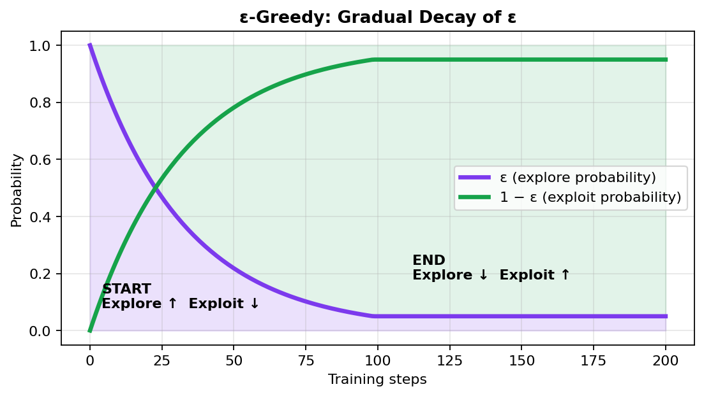

<div align="center">

# 🤖 Reinforcement Learning — Part 1

### *An agent interacting with an environment, learning from rewards and penalties*


</div>

---

## 📑 Table of Contents

1. [Reinforcement Learning](#1--reinforcement-learning)
2. [Components in RL](#2--components-in-rl)
3. [Components in Detail](#3--components-in-detail)
4. [Markov Decision Process (MDP)](#4--markov-decision-process-mdp)
5. [Understanding with a Grid Example](#5--understanding-with-a-grid-example)
6. [Policy Optimization in Grid](#6--policy-optimization-in-grid)
7. [Importance of Q-Functions](#7--importance-of-q-functions)
8. [Exploration–Exploitation Trade-Off](#8--explorationexploitation-trade-off)

---

## 1. 🎯 Reinforcement Learning

> **An Agent interacts with an Environment and learns from rewards and penalties.**

- 🦿 **Example:** A robot learning to walk.
- 🏆 **Goal:** The total **reward should be maximized**.

### 🔥 Turning Points

| Year | Milestone | Description |
|:----:|:----------|:------------|
| **2013** | DeepMind → **Deep Q Network (DQN)** | Integrated **RL + Deep Learning** |
| **2016** | **AlphaGo** | DeepMind designed AlphaGo to play Go and it **won against Lee Sedol** |

<p align="center"></p>

---

## 2. 🧩 Components in RL

<p align="center"></p>

| Component | Meaning |
|:----------|:--------|
| 🌍 **Environment** | The world the agent interacts with |
| 🤖 **Agent** | The learner / decision maker |
| 📸 **State (S)** | Snapshot of the environment |
| 🎬 **Action (A)** | What the agent does |
| 🎁 **Reward (R)** | Feedback received after an action |
| 🧭 **Policy (π)** | Strategy to choose an action → `π(a \| s)` |

The interaction loop:  `Sₜ, Aₜ  →  Rₜ₊₁`

---

## 3. 🔍 Components in Detail

### 💰 Return (Gₜ) / Total Future Rewards

At time **t**, we sum the future rewards:

```
Gₜ = Rₜ₊₁ + γ·Rₜ₊₂ + γ²·Rₜ₊₃ + ...
```

where **γ (gamma)** = **discount factor**, with `0 ≤ γ < 1`.

<p align="center"></p>

#### 🎚️ Effect of γ on Agent's Behaviour

| γ | Agent's Behaviour |
|:---:|:------------------|
| **0** | Only cares about immediate reward |
| **0.5** | Moderately considers future rewards |
| **0.9** | Strongly considers future rewards |

### 📈 Value Function (VF)

> **Expected future rewards from a state.**

**a) State Value Function** — estimates the return based on state *s*, followed by policy **π**:

```
Vπ(s) = Eπ [ Rₜ₊₁ + γ·Rₜ₊₂ + γ²·Rₜ₊₃ + ... | Sₜ = s ]
```

**b) Action Value Function** — `Qπ(s, a)`

| Type | Notation | Meaning |
|:-----|:--------:|:--------|
| Optimal State VF | `V*(s)` | Max possible return over all policies |
| Optimal Action VF | `Q*(s, a)` | Max possible return over all policies |

---

## 4. 🔗 Markov Decision Process (MDP)

> A **mathematical model** — basically a sequence of **State, Action, Reward** …

```
S₀ A₀ R₁ S₁ A₁ R₂ S₂ A₂ R₃ ...
```

<p align="center"></p>



### 📜 Markov Property Rule

> **The future depends only on the current state and action, not on past actions.**

```
Sₜ₊₁ ← Sₜ, Aₜ
```

Example: **Chess**

### ⚠️ Limitations

- ❌ Not applicable in all situations / environments
- ❌ History is ignored

### 🔄 Flow



### 🛠️ Algorithms

1. **Q-Learning**
2. **SARSA**
3. **Policy Gradient**

---

## 5. 🧱 Understanding with Grid Example

<p align="center"></p>

- **Allowed moves:** up, down, left, right
- **Terminate:** when **E** is reached **or** after **15 moves**

### 📐 MDP Definition for the Grid

| Element | Definition |
|:--------|:-----------|
| **S** (State) | `cell(i, j)` → 2 numbers |
| **A** (Action) | `0 – 3` → 4 numbers (up, down, left, right) |
| **R** (Reward) | Target **E** → `0`, all non-E cells → `-1` |

> 💡 **Note:** `-6 > -8` — a total reward of -6 is **better** than -8 (fewer steps taken to reach E).

### 🌐 World Model

> Understand **how the environment behaves**:  `P(Sₜ₊₁, Rₜ₊₁ | Sₜ, Aₜ)`

| Type | Description |
|:-----|:------------|
| **a) Model-Based RL** | Agent **learns or uses** a model of the environment |
| **b) Model-Free RL** | Agent does **not explicitly learn** the environment model — *Ex: Grid* |

---

## 6. ⚙️ Policy Optimization in Grid

> ⭐ **Best Algorithm for Policy Optimization → Policy Gradient Method**

### Model-Free RL



---

## 7. 🧠 Importance of Q-Functions

- `Qπ(s, a)` → estimates the **expected return** of taking action *a* in state *s* under policy π
- `Q*(s, a)` → the **optimal** Q-function; pick the action with the **highest** estimated return
- Acting on `Q*` is a **greedy** strategy

<p align="center"></p>

---

## 8. ⚖️ Exploration–Exploitation Trade-Off

In RL, an agent has to decide between:

| Choice | Meaning |
|:-------|:--------|
| 🔭 **Exploration** | Trying **new actions** to discover better rewards |
| 💎 **Exploitation** | Choosing / applying the action with the **max action value** |

> The challenge of balancing these two is called the **Exploration–Exploitation Trade-off**.

### 🎲 ε-Greedy Strategy

A simple method for balancing exploration and exploitation with probability **ε**.

**Steps**

1. First take **ε = 0.1**
2. Look at the Q-values:

   | Action | Q-Value |
   |:------:|:-------:|
   | Up | 5 |
   | Down | 3 |
   | Left | 1 |
   | Right | **10** ✅ |

3. Take a random value **r** in `(0 – 1)`

```python
import random

epsilon = 0.1
q_values = {"up": 5, "down": 3, "left": 1, "right": 10}

r = random.random()          # random value between 0 and 1

if r < epsilon:
    action = random.choice(list(q_values))      # 🔭 Explore
else:
    action = max(q_values, key=q_values.get)    # 💎 Exploit -> "right"
```

### 📉 Decay of ε

<p align="center"></p>

> In each complete step we **gradually decay ε**.

| Phase | Explore | Exploit |
|:------|:-------:|:-------:|
| **At Start** | ⬆️ High | ⬇️ Low |
| **At End** | ⬇️ Low | ⬆️ High |

---

<div align="center">

### ✨ Made by [Sayan](https://www.linkedin.com/in/sayanpal04?utm_source=share_via&utm_content=profile&utm_medium=member_android) ✨

[](https://www.linkedin.com/in/sayanpal04?utm_source=share_via&utm_content=profile&utm_medium=member_android)

⭐ *If these notes helped you, give the repo a star!* ⭐

</div>
