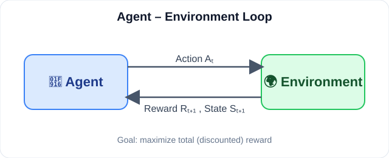
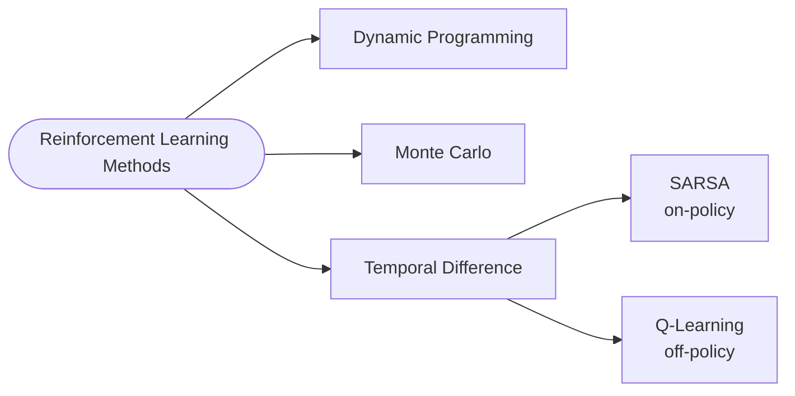
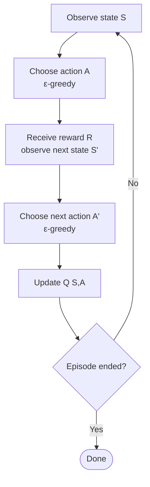
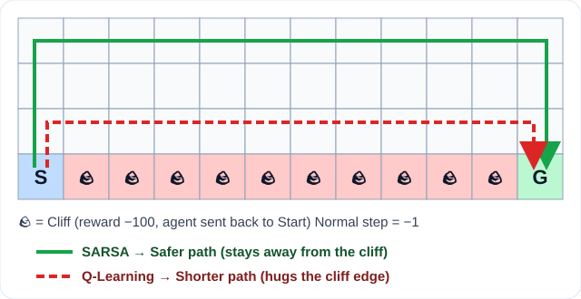

<div align="center">


**A clean, visual summary of core Reinforcement Learning methods — from Dynamic Programming to Q-Learning on the Cliff Walking environment.**

</div>

---

## 📑 Table of Contents

1. [Diverse RL Methods](#1--diverse-rl-methods)
2. [Dynamic Programming](#2--dynamic-programming)
3. [Monte Carlo Methods](#3--monte-carlo-methods)
4. [Temporal Difference (TD) Learning](#4--temporal-difference-td-learning)
5. [SARSA Algorithm](#5--sarsa-algorithm)
6. [Q-Learning Algorithm](#6--q-learning-algorithm)
7. [SARSA vs Q-Learning](#7--sarsa-vs-q-learning)
8. [Cliff-Walking Environment](#8--cliff-walking-environment)
9. [Implementation: SARSA](#9--implementation-sarsa)
10. [Implementation: Q-Learning](#10--implementation-q-learning)
11. [Quick Cheat Sheet](#11--quick-cheat-sheet)

---

## 1. 🧭 Diverse RL Methods

In Reinforcement Learning, an **agent** interacts with an **environment**, takes **actions**, and receives **rewards**. Its goal is to **maximize total reward**.

<div align="center">

</div>

There are three classic families of methods:

| # | Method | Needs a model of the environment? | Learns from |
|---|--------|:---:|-------------|
| 1 | **Dynamic Programming (DP)** | ✅ Yes (complete knowledge) | Full model / Bellman equation |
| 2 | **Monte Carlo (MC)** | ❌ No | Complete episodes |
| 3 | **Temporal Difference (TD)** | ❌ No | Single steps (bootstrapping) |



---

## 2. 🧮 Dynamic Programming

- Uses a **model** of the environment.
- Needs **complete knowledge** of the environment (transition probabilities and rewards).

### Bellman Equation

```math
V(s) = \max_a \Big( R(s,a) + \gamma \, V(s') \Big)
```

where **γ (gamma)** is the discount factor.

### ⚠️ Disadvantages of Dynamic Programming

1. The model must have **complete knowledge** of the environment.
2. Poor **scalability**.
3. **Computationally expensive** for large MDPs.

---

## 3. 🎲 Monte Carlo Methods

Monte Carlo methods work on **episodes**, i.e. **experienced samples** — no model required.

### Return in Monte Carlo

```math
G_t = R_{t+1} + \gamma R_{t+2} + \gamma^2 R_{t+3} + \dots
```

| Symbol | Meaning |
|:---:|---|
| `γ` | Discount factor |
| `R_{t+1}` | Next reward |

### 🎮 Example

An agent plays several games and receives rewards based on performance. If it visits a state **3 times** and observes returns of **10, 6, 8**:

```math
V(s) = \frac{10 + 6 + 8}{3} = 8
```

> The agent estimates that state `s` has a value of **8**.

### Value Function Estimation

```math
V(s) = \frac{1}{N(s)} \sum_{i=1}^{N(s)} G_i(s)
```

- `N(s)` = number of times the state has been sampled.

### ⚠️ Disadvantages

1. **Episode-based** → long episodes ⇔ slow learning.
2. **Exploring** enough states and actions can be difficult.

---

## 4. ⏱️ Temporal Difference (TD) Learning

TD is a **model-free** method. It learns the value of a state by updating its estimate using the **immediate reward** and the **estimated value of the next step**.

### TD Update Rule

```math
V(S_t) \leftarrow V(S_t) + \alpha \Big[ R_{t+1} + \gamma V(S_{t+1}) - V(S_t) \Big]
```

| Symbol | Meaning |
|:---:|---|
| `V(S_t)` | Current estimate value of state |
| `α` | Learning rate |
| `R_{t+1}` | Immediate reward |
| `γ` | Discount factor |
| `V(S_{t+1})` | Estimated value of next state |

### TD Error

```math
\delta_t = R_{t+1} + \gamma V(S_{t+1}) - V(S_t)
```

> The TD error tells us **how different the new target is from the current estimate.**

### 🔢 Quick Numeric Example

`V(S_t)=5`, `α=0.1`, `R=1`, `γ=0.9`, `V(S_{t+1})=6`

- Target = `1 + 0.9×6 = 6.4`
- TD error δ = `6.4 − 5 = 1.4`
- New `V(S_t)` = `5 + 0.1×1.4 = 5.14`

### Types of TD Algorithms

1. **SARSA**
2. **Q-Learning**

### 🆚 Monte Carlo vs TD

| | Monte Carlo | Temporal Difference |
|---|---|---|
| Update happens | End of episode | Every step |
| Uses | Full return `G_t` | `R + γV(s')` (bootstrap) |
| Speed | Slower on long episodes | Faster |

---

## 5. 🚗 SARSA Algorithm

In SARSA, the model **learns to act in an environment**. **Goal: maximize total rewards.**

The name comes from the sequence it uses:

| Letter | Meaning |
|:---:|---|
| **S** | State |
| **A** | Action |
| **R** | Reward |
| **S′** | Next State |
| **A′** | Next Action |

```
Sₜ → Aₜ → Rₜ₊₁ → Sₜ₊₁ → Aₜ₊₁ → ...
```

### How it works

1. Observe current state `Sₜ`
2. Choose action `Aₜ` using a policy such as **ε-greedy**
3. Receive reward `Rₜ₊₁` and observe `Sₜ₊₁`
4. Choose next action `Aₜ₊₁`
5. Update `Q(Sₜ, Aₜ)`
6. Repeat until the episode ends



### SARSA Update Formula

```math
Q(s,a) \leftarrow Q(s,a) + \alpha \Big[ R_{t+1} + \gamma \, Q(s',a') - Q(s,a) \Big]
```

> ⭐ **SARSA is an *on-policy* algorithm.** On-policy means it learns the value of the very policy the agent is following — it tells the agent which action to take in a given state, and learns from the action it actually takes next.

---

## 6. 🎯 Q-Learning Algorithm

Q-Learning is an **off-policy** algorithm because the policy used to **choose actions** can be different from the policy used to **learn the optimal values**.

### Steps

1. Initialize Q-values
2. Observe current state `Sₜ`
3. Choose action `Aₜ` → policy (**ε-greedy**)
4. Observe reward `Rₜ₊₁` and next state `Sₜ₊₁`
5. Update Q-value (use the **max** value at `Sₜ₊₁`)
6. Repeat

### Q-Learning Update Formula

```math
Q(s,a) \leftarrow Q(s,a) + \alpha \Big[ R + \gamma \max_{a'} Q(s',a') - Q(s,a) \Big]
```

### 🔢 Small Update Example

`Q(s,a)=0.5`, `α=0.1`, `R=−1`, `γ=0.9`, `max Q(s',a')=2.0`

- Target = `−1 + 0.9×2.0 = 0.8`
- Error = `0.8 − 0.5 = 0.3`
- New `Q(s,a)` = `0.5 + 0.1×0.3 = 0.53`

---

## 7. ⚔️ SARSA vs Q-Learning

> **SARSA → Safer path**
> **Q-Learning → Shorter path**

<div align="center">

</div>

| Feature | SARSA | Q-Learning |
|---|---|---|
| Policy type | **On-policy** | **Off-policy** |
| Next-state value | `Q(s', a')` (action actually taken) | `max Q(s', a')` (best action) |
| Behaviour near danger | Cautious (accounts for exploration) | Greedy / optimistic |
| Resulting path | 🟢 **Safer path** | 🔴 **Shorter path** |
| Analogy | **Driver 1** – takes the safe road | **Driver 2** – takes the risky shortcut |

---

## 8. 🧗 Cliff-Walking Environment

A classic gridworld used to compare SARSA and Q-Learning.

```
┌───────┬───────┬───────┬───────┐
│ Start │       │       │ Goal  │
├───────┼───────┼───────┼───────┤
│       │ Cliff │ Cliff │ Cliff │
└───────┴───────┴───────┴───────┘
```
*(Simplified view. The real Gymnasium environment is a 4 × 12 grid with the cliff along the bottom row.)*

| Rule | Value |
|---|---|
| ☠️ Stepping onto the cliff | **Reward −100** and the agent is **returned to start** |
| 🚶 Normal move | **−1 per step** |
| 🎮 Actions | **Up, Down, Left, Right** |

### Methods of the `env` object

| # | Purpose | Method |
|:-:|---|---|
| 1 | Create | `make()` |
| 2 | Show | `render()` |
| 3 | Reset | `reset()` |
| 4 | Close | `close()` |
| 5 | Action | `step()` |

### Creation of Env

```python
import gymnasium as gym

env = gym.make("CliffWalking-v1")
```

> 💡 Install first: `pip install gymnasium numpy`

---

## 9. 🛠️ Implementation: SARSA

```python
import gymnasium as gym
import numpy as np

env = gym.make("CliffWalking-v1")
n_states, n_actions = env.observation_space.n, env.action_space.n

Q = np.zeros((n_states, n_actions))
alpha, gamma, epsilon = 0.1, 0.99, 0.1
episodes = 500

def epsilon_greedy(state):
    if np.random.rand() < epsilon:
        return env.action_space.sample()
    return int(np.argmax(Q[state]))

for ep in range(episodes):
    state, _ = env.reset()
    action = epsilon_greedy(state)
    done = False

    while not done:
        next_state, reward, terminated, truncated, _ = env.step(action)
        done = terminated or truncated
        next_action = epsilon_greedy(next_state)          # A' chosen BEFORE the update

        # SARSA update: uses Q(s', a')
        target = reward + gamma * Q[next_state, next_action] * (not terminated)
        Q[state, action] += alpha * (target - Q[state, action])

        state, action = next_state, next_action
```

### ✅ What the agent learnt with SARSA

The agent learns a **safer path**, moving **away from the cliff edge**, because the update accounts for the chance that exploration (ε-greedy) might push it off the cliff.

---

## 10. 🛠️ Implementation: Q-Learning

```python
import gymnasium as gym
import numpy as np

env = gym.make("CliffWalking-v1")
n_states, n_actions = env.observation_space.n, env.action_space.n

Q = np.zeros((n_states, n_actions))
alpha, gamma, epsilon = 0.1, 0.99, 0.1
episodes = 500

def epsilon_greedy(state):
    if np.random.rand() < epsilon:
        return env.action_space.sample()
    return int(np.argmax(Q[state]))

for ep in range(episodes):
    state, _ = env.reset()
    done = False

    while not done:
        action = epsilon_greedy(state)
        next_state, reward, terminated, truncated, _ = env.step(action)
        done = terminated or truncated

        # Q-Learning update: uses max Q(s', a')
        target = reward + gamma * np.max(Q[next_state]) * (not terminated)
        Q[state, action] += alpha * (target - Q[state, action])

        state = next_state
```

### ✅ What the agent learnt with Q-Learning

The agent learns the **optimal, shorter path** that runs right along the cliff edge. It is optimal in theory, but during training with ε-greedy exploration it falls off the cliff more often.

### 👀 Watch the trained agent

```python
env = gym.make("CliffWalking-v1", render_mode="human")
state, _ = env.reset()
done = False
while not done:
    action = int(np.argmax(Q[state]))
    state, reward, terminated, truncated, _ = env.step(action)
    done = terminated or truncated
env.close()
```

---

## 11. 📝 Quick Cheat Sheet

| Concept | Formula / Idea |
|---|---|
| Bellman | `V(s) = max_a ( R(s,a) + γV(s') )` |
| MC return | `Gₜ = Rₜ₊₁ + γRₜ₊₂ + γ²Rₜ₊₃ + …` |
| MC value | `V(s) = (1/N(s)) Σ Gᵢ(s)` |
| TD update | `V(Sₜ) ← V(Sₜ) + α[R + γV(Sₜ₊₁) − V(Sₜ)]` |
| TD error | `δₜ = R + γV(Sₜ₊₁) − V(Sₜ)` |
| SARSA | `Q(s,a) ← Q(s,a) + α[R + γQ(s',a') − Q(s,a)]` |
| Q-Learning | `Q(s,a) ← Q(s,a) + α[R + γ max Q(s',a') − Q(s,a)]` |

---

## 📚 Further Reading

- 📘 [Reinforcement Learning: An Introduction – Sutton & Barto](http://incompleteideas.net/book/the-book-2nd.html)
- 🏋️ [Gymnasium Docs – Cliff Walking](https://gymnasium.farama.org/environments/toy_text/cliff_walking/)

---

<div align="center">

### Made with ❤️ by [**Sayan**](https://www.linkedin.com/in/sayanpal04?utm_source=share_via&utm_content=profile&utm_medium=member_android)

[](https://www.linkedin.com/in/sayanpal04?utm_source=share_via&utm_content=profile&utm_medium=member_android)

⭐ If you found this helpful, give it a star!


</div>
