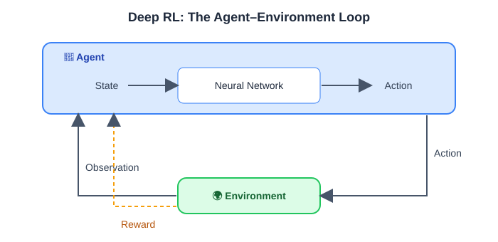
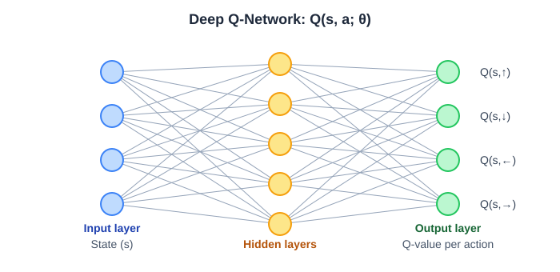
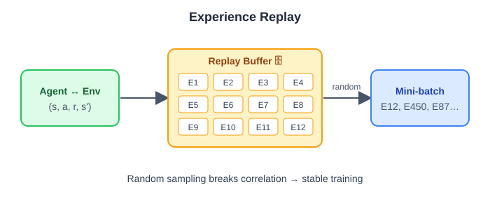
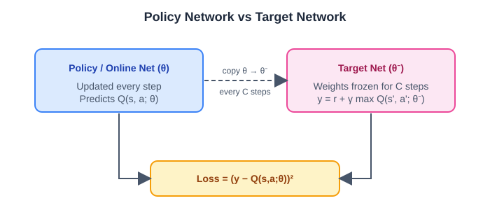
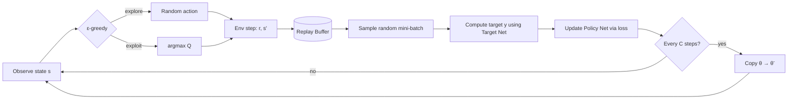

<div align="center">

# 🧠 Reinforcement Learning — Part 3
### Deep RL · Deep Q-Networks · Experience Replay · Target Networks


</div>

---

## 📚 Table of Contents
1. [Deep Reinforcement Learning](#1--deep-reinforcement-learning)
2. [Deep Q-Networks (DQN)](#2--deep-q-networks-dqn)
3. [Experience Replay](#3--experience-replay)
4. [Moving Target & Target Networks](#4--moving-target--target-networks)
5. [Full DQN Algorithm](#5--full-dqn-algorithm)
6. [Code Example (PyTorch)](#6--code-example-pytorch)
7. [Beyond DQN](#7--beyond-dqn)
8. [Quick Revision Cheat Sheet](#8--quick-revision-cheat-sheet)

---

## 1. 🤖 Deep Reinforcement Learning

> **Deep Learning + Reinforcement Learning = Deep Reinforcement Learning (DRL)**

DRL is used to **train an intelligent agent to make decisions through interaction with an environment**.

```
State  ──►  Neural Network  ──►  Action
```

<p align="center">
  
</p>

| Term | Meaning |
|------|---------|
| **Agent** | The learner / decision maker (here, a neural network) |
| **Environment** | Everything the agent interacts with |
| **State (s)** | Current situation of the environment |
| **Action (a)** | A choice the agent makes |
| **Reward (r)** | Feedback signal for the action |

**🚀 Used in:** Robotics 🦾 · Game-playing AI 🎮 · Self-driving cars 🚗 · Recommendation systems · Finance

---

## 2. 🕸️ Deep Q-Networks (DQN)

DQN **combines Q-Learning with a Deep Neural Network.**

<p align="center">
  
</p>

- **Input layer:** the state (e.g. 48 nodes for a 48-state environment)
- **Hidden layers:** learn features
- **Output layer:** one Q-value per action (e.g. 4 actions)
- Instead of a **Q-table (48 × 4)**, the network approximates it. This scales to huge state spaces where a table is impossible.

### Q-Learning vs DQN

| | Q-Learning | DQN |
|---|---|---|
| Representation | Q-table | Neural network |
| Notation | `Q(s, a)` | `Q(s, a; θ)` |
| Scales to large states | ❌ | ✅ |

where **θ = network parameters (weights)**.

### ⚠️ Two Problems with Naive DQN
1. **Correlated samples**
2. **Moving target**

Each has a solution 👇

---

## 3. 🔁 Experience Replay

### Problem: Correlated Samples
Samples are **sequential and correlated** — each experience flows into the next:

```
E1: S1 → A1 → R1 → S2
E2: S2 → A2 → R2 → S3
E3: S3 → A3 → R3 → S4
```

**Why is this bad?**
1. The network **learns repeated information**
2. **Training becomes unstable**

> 🐱 **Analogy:** Teaching a student with Cat 1 → Cat 2 → Cat 3 → Cat 4, where all four are identical. The student learns nothing new and overfits.

### ✅ Solution: Experience Replay
Store past experiences in a **memory buffer** and **randomly sample a batch** for training.

<p align="center">
  
</p>

### Step-by-step example

**Step 1 — The AI collects experiences**

| Experience | Action | Reward |
|---|---|---|
| 1 | Move Right ➡️ | **+1** |
| 2 | Move Right ➡️ | **+1** |
| 3 | Hit a wall 🧱 | **−5** |
| 4 | Reach the goal 🏆 | **+10** |

Each experience is stored as a tuple: **`(sₜ, aₜ, rₜ, sₜ₊₁)`**

**Step 2 — Store in the Replay Buffer**

```
┌──────────────────────────────────────────┐
│  Exp 1 (+1)   Exp 2 (+1)                 │
│  Exp 3 (−5)   Exp 4 (+10)   ...          │
└──────────────────────────────────────────┘
```

**Step 3 — Randomly select a training batch**
e.g. `E12 → E450 → E87 → ...`

### 🎯 Benefits
- ✅ Breaks correlation between samples
- ✅ Reuses data (**sample efficient**)
- ✅ Smoother, more stable training

---

## 4. 🎯 Moving Target & Target Networks

### Problem: The Moving Target
Imagine you're playing a game and your teacher says:
- Current score: **5**
- Target score: **10**

As you get closer, the teacher **changes the target from 10 to 15**. You keep chasing a goal that never stays still. 😵

This is the **Moving Target Problem in DQN.**

The target is calculated as:

```math
y = r + \gamma \max_{a'} Q(s', a'; \theta)
```

Here **θ affects both the prediction and the target** — so every update shifts both, causing instability.

### ✅ Solution: Target Network
A **separate neural network** used to calculate Q-values **more stably** during training.

<p align="center">
  
</p>

DQN uses **two networks**:

| Network | Role |
|---|---|
| **Policy / Online Network** | Updates weights during training. **All learning is done here.** |
| **Target Network** | Keeps its weights **fixed for a period of time** (an old copy of the policy network). |

The corrected target uses the frozen weights **θ⁻**:

```math
y = r + \gamma \max_{a'} Q(s', a'; \theta^{-})
```

```math
\mathcal{L}(\theta) = \big(y - Q(s, a; \theta)\big)^2
```

---

## 5. 🧩 Full DQN Algorithm



1. Initialize policy network `θ`, target network `θ⁻ = θ`, replay buffer `D`
2. For each step: choose action with **ε-greedy**, store `(s, a, r, s')` in `D`
3. Sample a **random mini-batch** from `D`
4. Compute target `y = r + γ · maxₐ' Q(s', a'; θ⁻)` (no bootstrap if `s'` is terminal)
5. Minimize `(y − Q(s, a; θ))²` with gradient descent
6. Every `C` steps, copy `θ → θ⁻`

---

## 6. 💻 Code Example (PyTorch)

```python
import random, copy
from collections import deque
import torch, torch.nn as nn, torch.nn.functional as F

class QNetwork(nn.Module):
    def __init__(self, state_dim, n_actions):
        super().__init__()
        self.net = nn.Sequential(
            nn.Linear(state_dim, 128), nn.ReLU(),
            nn.Linear(128, 128), nn.ReLU(),
            nn.Linear(128, n_actions),
        )
    def forward(self, x):
        return self.net(x)

class ReplayBuffer:
    def __init__(self, capacity=100_000):
        self.buffer = deque(maxlen=capacity)
    def push(self, s, a, r, s2, done):
        self.buffer.append((s, a, r, s2, done))
    def sample(self, batch_size):
        batch = random.sample(self.buffer, batch_size)      # random → breaks correlation
        s, a, r, s2, d = map(lambda x: torch.tensor(x, dtype=torch.float32), zip(*batch))
        return s, a.long(), r, s2, d
    def __len__(self):
        return len(self.buffer)

policy_net = QNetwork(state_dim=48, n_actions=4)
target_net = copy.deepcopy(policy_net)                       # old copy of policy net
optimizer  = torch.optim.Adam(policy_net.parameters(), lr=1e-3)
gamma = 0.99

def train_step(buffer, batch_size=64):
    if len(buffer) < batch_size:
        return
    s, a, r, s2, done = buffer.sample(batch_size)
    q = policy_net(s).gather(1, a.unsqueeze(1)).squeeze(1)   # Q(s,a;θ)
    with torch.no_grad():
        y = r + gamma * target_net(s2).max(1)[0] * (1 - done) # target uses θ⁻
    loss = F.mse_loss(q, y)
    optimizer.zero_grad(); loss.backward(); optimizer.step()

# every C steps:
# target_net.load_state_dict(policy_net.state_dict())
```

---

## 7. 🚀 Beyond DQN

| Variant | Idea |
|---|---|
| **Double DQN** | Reduces Q-value overestimation by decoupling action selection and evaluation |
| **Dueling DQN** | Separates state-value `V(s)` and advantage `A(s,a)` streams |
| **Prioritized Experience Replay** | Samples important (high-error) experiences more often |
| **Rainbow DQN** | Combines many improvements in one agent |
| **Policy-gradient / Actor-Critic** (A2C, PPO, SAC) | Learn the policy directly — natural next topic |

### 🔧 Common Hyperparameters
| Parameter | Typical value |
|---|---|
| Discount factor γ | 0.95 – 0.99 |
| Learning rate | 1e-4 – 1e-3 |
| Replay buffer size | 10⁴ – 10⁶ |
| Batch size | 32 – 128 |
| Target update interval C | 500 – 10,000 steps |
| ε (exploration) | 1.0 → 0.01 (decayed) |

### 🎮 Practice Environments
[Gymnasium](https://gymnasium.farama.org/) — CartPole, LunarLander, FrozenLake, CliffWalking, Atari

### 📖 References
- Mnih et al., *Playing Atari with Deep Reinforcement Learning* (2013)
- Mnih et al., *Human-level control through deep reinforcement learning*, Nature (2015)
- Sutton & Barto, *Reinforcement Learning: An Introduction*

---

## 8. ⚡ Quick Revision Cheat Sheet

| Concept | One-liner |
|---|---|
| **DRL** | Deep Learning + RL: neural net maps state → action |
| **DQN** | Q-Learning with a neural network, `Q(s,a;θ)` |
| **Correlated samples** | Sequential data → repeated info, unstable training |
| **Experience Replay** | Buffer + random mini-batches fix correlation |
| **Moving target** | θ changes both prediction and target |
| **Target network** | Frozen old copy of policy net gives stable targets |

---

<div align="center">

### ✨ Made with ❤️ by [**Sayan**](https://www.linkedin.com/in/sayanpal04?utm_source=share_via&utm_content=profile&utm_medium=member_android)

[](https://www.linkedin.com/in/sayanpal04?utm_source=share_via&utm_content=profile&utm_medium=member_android)

⭐ If this helped you, give the repo a star!

</div>
