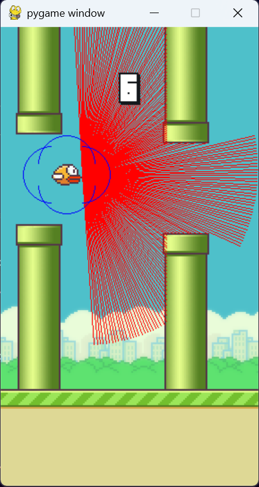
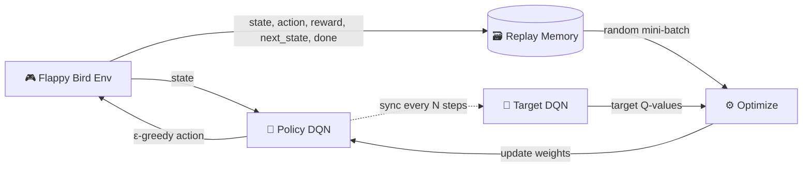

<div align="center">


### 🐦 Teaching an AI to play Flappy Bird using Deep Q-Learning (DQN)


<br/>



<sub>The agent sees the world through 180 LiDAR rays (red lines) and decides when to flap.</sub>

</div>

---

## 📖 Table of Contents

1. [About the Project](#-about-the-project)
2. [How It Works](#-how-it-works)
3. [Project Structure](#-project-structure)
4. [Roadmap (Part 4)](#-roadmap--what-we-build)
5. [Hyperparameters](#-hyperparameters)
6. [Installation](#-installation)
7. [Usage](#-usage)
8. [Key Concepts](#-key-concepts)
9. [Future Improvements](#-future-improvements)
10. [Author](#-author)

---

## 🎯 About the Project

This project is **Part 4** of my **Reinforcement Learning** series. We build a complete **Deep Q-Network (DQN)** agent from scratch with **PyTorch** that learns to play **Flappy Bird** purely by trial and error, with no hand-written rules and no human demonstrations.

The agent observes the game state, picks one of two actions (**do nothing** or **flap**), receives a reward, and gradually learns a policy that keeps the bird alive and flying through the pipes.

| Item | Detail |
|---|---|
| **Environment** | `FlappyBird-v0` via [`flappy-bird-gymnasium`](https://github.com/markub3327/flappy-bird-gymnasium) |
| **Algorithm** | Deep Q-Network (DQN) with Experience Replay and Target Network |
| **Actions** | `0` = no flap, `1` = flap |
| **Observation** | LiDAR readings (180 values) or 12 features when LiDAR is disabled |
| **Framework** | PyTorch |

---

## 🧠 How It Works



**The learning loop**

1. The agent observes the current **state**.
2. It picks an action using **ε-greedy**: explore randomly at first, exploit what it learned later.
3. The environment returns the **next state** and a **reward**.
4. The experience is saved in the **Replay Memory**.
5. A random **mini-batch** is sampled to break correlation between consecutive frames.
6. The **policy network** is trained towards the Bellman target computed by the **target network**:

$$
Q_{target} = r + \gamma \cdot (1 - done) \cdot \max_{a'} Q_{target}(s', a')
$$

7. Every few steps, the target network copies the policy network's weights.

---

## 📁 Project Structure

```
Flappy_Bird_Project/
│
├── agent.py               # Agent: training loop, testing loop, optimization
├── dqn.py                 # The neural network (DQN)
├── experience_replay.py   # Replay memory (FIFO buffer)
├── game_flappy_bird.py    # Play the game yourself with the SPACE key
├── parameters.yaml        # All hyperparameters in one place
├── assets/                # Images used in this README
└── runs/                  # Auto-created: saved model (.pt) and training log
```

---

## 🗺️ Roadmap / What We Build

| Step | Topic | File |
|:---:|---|---|
| 1 | DQN for Flappy Bird game | `agent.py` |
| 2 | Build our DQN | `dqn.py` |
| 3 | Setting up the environment | `game_flappy_bird.py` |
| 4 | Building Experience Replay | `experience_replay.py` |
| 5 | Defining hyperparameters | `parameters.yaml` |
| 6 | Implementing ε-greedy decay | `agent.py` |
| 7 | Building the Target Network and training the DQN | `agent.py` |
| 8 | Final touches | `runs/`, logging, saving the best model |
| 9 | 🏆 **Trained Flappy Bird RL Agent** | ✅ |

---

## ⚙️ Hyperparameters

Defined in [`parameters.yaml`](parameters.yaml):

| Parameter | Value | Meaning |
|---|:---:|---|
| `epsilon_init` | `1` | Start fully random (100% exploration) |
| `epsilon_min` | `0.05` | Always keep 5% exploration |
| `epsilon_decay` | `0.9995` | Multiply ε by this after every episode |
| `replay_memory_size` | `100000` | Max experiences stored |
| `mini_batch_size` | `32` | Samples used per training step |
| `network_sync_rate` | `10` | Steps between target network updates |
| `alpha` | `0.001` | Learning rate (Adam) |
| `gamma` | `0.99` | Discount factor for future rewards |
| `reward_threshold` | `1000` | Episode stops once this reward is reached |

---

## 🛠️ Installation

```bash
# 1. Clone the repository
git clone https://github.com/<your-username>/Flappy_Bird_Project.git
cd Flappy_Bird_Project

# 2. Create and activate a virtual environment
python -m venv .venv
.venv\Scripts\activate          # Windows
# source .venv/bin/activate     # macOS / Linux

# 3. Install dependencies
pip install torch gymnasium flappy-bird-gymnasium pygame pyyaml
```

---

## 🚀 Usage

**🎮 Play the game yourself** (press `SPACE` to flap)

```bash
python game_flappy_bird.py
```

**🏋️ Train the agent**

```bash
python agent.py flappybirdv0 --train
```

The best model is saved to `runs/flappybirdv0.pt` and progress is logged to `runs/flappybirdv0.log`.

**👀 Watch the trained agent play**

```bash
python agent.py flappybirdv0
```

---

## 💡 Key Concepts

- **Deep Q-Network (DQN):** a neural network that approximates the Q-function, i.e. the expected future reward of each action in a given state.
- **Experience Replay:** storing past transitions and training on random samples to stabilise learning.
- **ε-greedy exploration:** balancing trying new things (explore) with using what is known (exploit); ε decays over time.
- **Target Network:** a slowly updated copy of the policy network that provides stable learning targets.
- **LiDAR observation:** distance rays that let the bird "see" pipes and the ground.

---

## 🔮 Future Improvements

- [ ] Double DQN to reduce Q-value overestimation
- [ ] Dueling DQN architecture
- [ ] Prioritized Experience Replay
- [ ] Reward-curve plotting with Matplotlib
- [ ] Hyperparameter search

---

## 👨‍💻 Author

<div align="center">

### Made with ❤️ by [Sayan](https://www.linkedin.com/in/sayanpal04)

[](https://www.linkedin.com/in/sayanpal04)

⭐ If you liked this project, give it a star!


</div>
