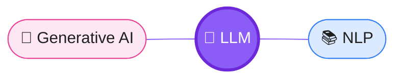
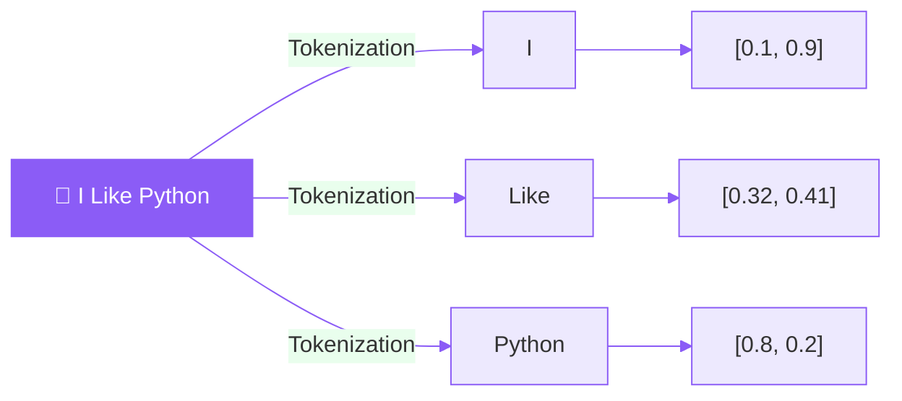
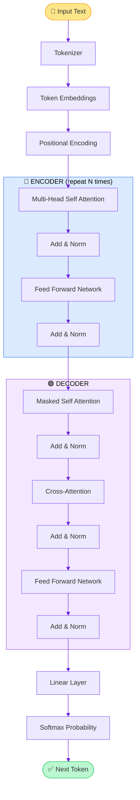
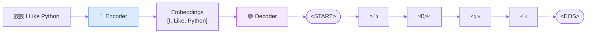
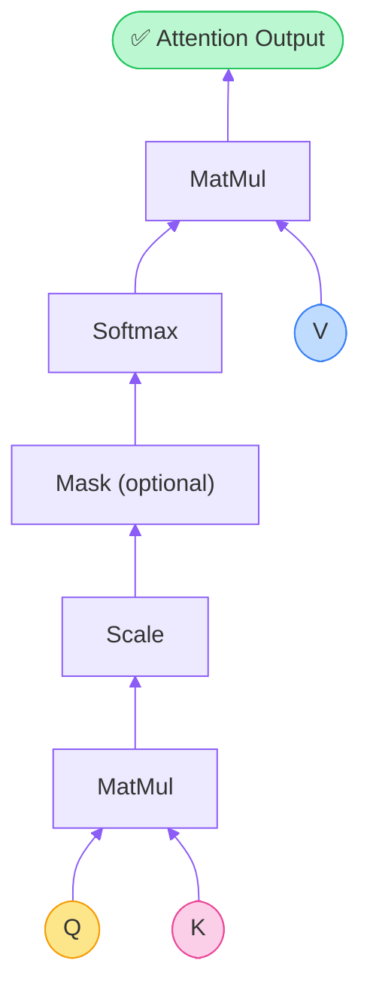
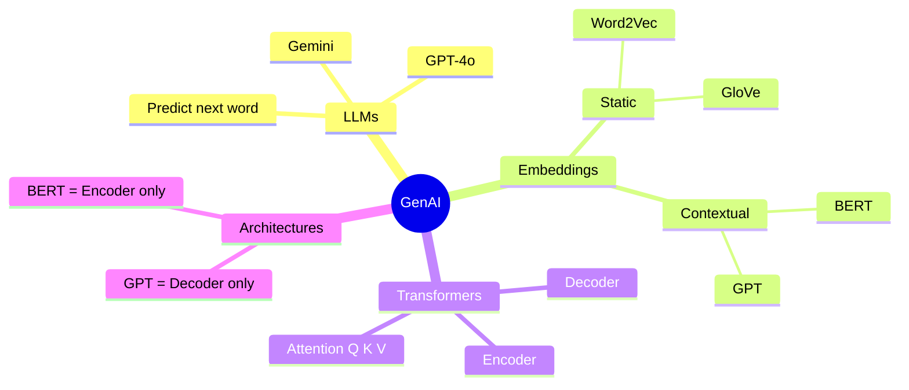

<div align="center">


<a href="https://git.io/typing-svg">
  
</a>

<br/>


<br/><br/>


</div>

<br/>

> [!NOTE]
> A clean, visual walkthrough of **Generative AI**: from *"what is an LLM?"* all the way to the maths behind **Scaled Dot-Product Attention**.


## 🧭 Roadmap

<div align="center">

| | | |
|:---:|:---:|:---:|
| **🎨 01**<br/>[Intro to GenAI](#-1-introduction-to-genai) | **🧠 02**<br/>[What are LLMs?](#-2-what-are-llms) | **⚡ 03**<br/>[Intro to Transformers](#-3-introduction-to-transformers) |
| **🔢 04**<br/>[Static vs Contextual](#-4-embeddings-static-vs-contextual) | **🏗️ 05**<br/>[Architecture Overview](#️-5-transformer-architecture-overview) | **🔄 06**<br/>[Encoder & Decoder](#-6-encoder--decoder) |
| **🧬 07**<br/>[Transformer Variants](#-7-various-transformer-architectures) | **🎯 08**<br/>[Attention Is All You Need](#-8-attention-is-all-you-need) | **🧮 09**<br/>[Scaled Dot-Product](#-9-scaled-dot-product-attention) |

</div>


## 🎨 1. Introduction to GenAI

> **Generative AI (GenAI)** is a subfield of AI that **creates new content**, such as audio, video, images, text and more.

<div align="center">

| 🖼️ Images | 🎵 Audio | 🎬 Video | 💬 Text | 💻 Code |
|:---:|:---:|:---:|:---:|:---:|
| Generate art | Generate speech & music | Generate clips | Chat & write | Write programs |

</div>

### 🛠️ Popular GenAI Tools

<div align="center">

| 🟠 Claude | 🟢 ChatGPT | 🔵 Copilot |
|:---:|:---:|:---:|
| by **Anthropic** | by **OpenAI** | by **Microsoft** |

</div>


## 🧠 2. What are LLMs?

**Language Model:** an AI system used to **predict the most likely next word based on context**.

```text
How are ____ ?   ──▶   you
```

**LLM (Large Language Model):** an advanced AI system trained on a **huge amount of data** to **understand, generate or summarize** human language and code.



> [!TIP]
> LLMs live at the **intersection of GenAI and NLP**.

### 🆚 Application vs. Engine (LLM)

<div align="center">

| 📱 Application | ⚙️ Engine behind it (LLM) |
|:---:|:---:|
| **ChatGPT** | GPT-4o, GPT-4 |
| **Gemini** | Gemini 2.5 Flash, Gemini Nano |

</div>


## ⚡ 3. Introduction to Transformers

- 📅 Introduced in **2017** in the research paper **"Attention Is All You Need"**
- 🧩 Transformers are a **neural network architecture** that uses **attention** to understand the relationships between **tokens** and generate meaningful output.

<div align="center">
  
  <br/>
  <sub><i>The Transformer architecture · Source: Wikimedia Commons</i></sub>
</div>


## 🔢 4. Embeddings: Static vs Contextual

> **Embedding** = a **numerical representation of each token.**



Each number captures a feature, such as *"Is it a mammal?"* or *"Is it a language?"*.

> [!IMPORTANT]
> In **GPT-3**, embeddings have **≈ 12,288 dimensions** (12K+).

### 🧊 Static  vs  🌊 Contextual

<div align="center">

| | 🧊 **Static Embeddings** | 🌊 **Contextual Embeddings** |
|:---|:---|:---|
| **Idea** | One **fixed vector** per word, regardless of context | **Different vectors** based on context |
| **Examples** | Word2Vec, GloVe | GPT-style models, BERT |
| `book` in *"I will read **book**"* | `[0.21, 0.54, 0.73, …]` | `[0.91, 0.23, 0.45, …]` |
| `book` in *"I will **book** tickets"* | `[0.21, 0.54, 0.73, …]` ⚠️ *same!* | `[0.12, 0.84, 0.31, …]` ✅ *different!* |

</div>

> [!TIP]
> ⭐ **Modern GenAI is built on contextual embeddings.**


## 🏗️ 5. Transformer Architecture Overview




## 🔄 6. Encoder & Decoder

<div align="center">

| 🔵 Encoder | 🟣 Decoder |
|:---:|:---:|
| Understands our speech/text **in terms of embeddings** | Used for **translation / generation** |

</div>

### 🗣️ Example: Translation



At every step, the decoder picks the next word using **probabilities**:

<div align="center">

| Candidate word | Probability | |
|:---:|:---:|:---|
| **আমি** | **72 %** | ████████████████████ ✅ |
| আমার | 10 % | ███ |
| আপনি | 0.2 % | ▏ |

</div>

> `<START>` marks the beginning · `<EOS>` = **End of Sequence**


## 🧬 7. Various Transformer Architectures

<table align="center">
<tr>
<td width="50%" valign="top">

### 🔵 BERT
**Encoder-only** Transformer

- ✅ Text classification
- ✅ Sentiment analysis
- 👁️ **Understands** text only

</td>
<td width="50%" valign="top">

### 🟣 GPT
**Decoder-only** Transformer

- ✅ Chat
- ✅ Generation & coding
- ✍️ **Generates** text

</td>
</tr>
</table>


## 🎯 8. Attention Is All You Need

Attention decides **which information matters most** for a given query.

> **Query (Q):** *What is the capital of India?*

<div align="center">

| | Key (K) | Value (V) | Match Weight |
|:---:|:---:|:---|:---:|
| **R** | 🌍 Geography | Capital of India | 🟢 **0.80** · strong |
| **S** | ➗ Math | 2 + 2 = 4 | 🔴 **0.05** · low |
| **G** | 📜 History | Independence / Constitution of India | 🟡 **0.10** · medium |

</div>

> [!IMPORTANT]
> Attention depends on **3 components, Q · K · V**, which together produce the **attention score**: `Attention(Q, K, V)`


## 🧮 9. Scaled Dot-Product Attention



### 🪜 Step-by-step

**1️⃣ &nbsp; Start with the input matrix `X`**

$$X \in \mathbb{R}^{n \times d}$$

`n` = number of tokens &nbsp;·&nbsp; `d` = embedding / model dimension

**2️⃣ &nbsp; Create Q, K, V** using learnable weights `W_Q`, `W_K`, `W_V`

$$Q = XW_Q \qquad K = XW_K \qquad V = XW_V$$

**3️⃣ &nbsp; Similarity score**

$$QK^T$$

**4️⃣ &nbsp; Scaling**

$$\frac{QK^T}{\sqrt{d_k}}$$

**5️⃣ &nbsp; Softmax**: converts the scores into **probabilities**

$$\text{softmax}\left(\frac{QK^T}{\sqrt{d_k}}\right)$$

**6️⃣ &nbsp; Second MatMul** with `V`

### ✅ Final Formula

$$\boxed{\;\text{Attention}(Q,K,V)=\text{softmax}\left(\frac{QK^T}{\sqrt{d_k}}\right)V\;}$$

> [!TIP]
> ✨ **This is Scaled Dot-Product Attention.**


## 🗺️ Quick Summary



<br/>

<div align="center">


### ✍️ Made with ❤️ by **Sayan Pal**

<a href="https://www.linkedin.com/in/sayanpal04/">
  
</a>

<br/><br/>

<sub>⭐ If these notes helped you, drop a star on the repo and share it with a friend!</sub>

</div>
