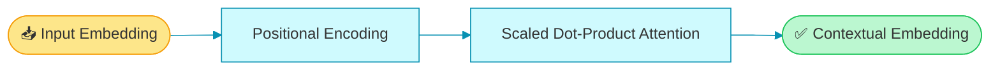
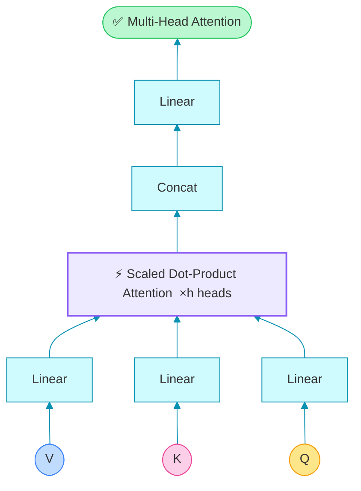
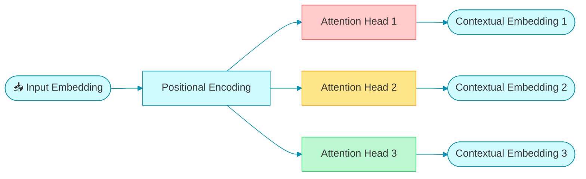
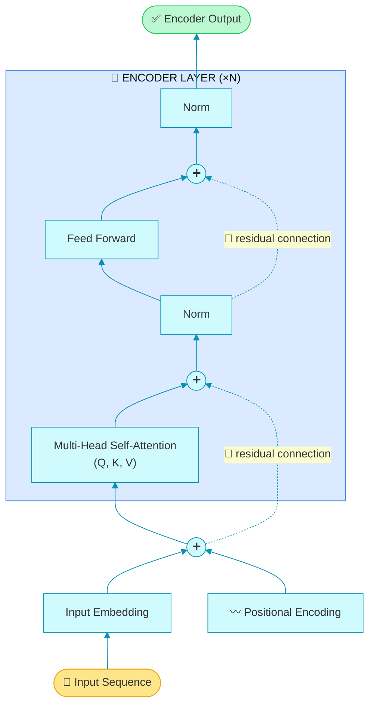
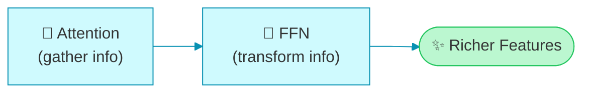
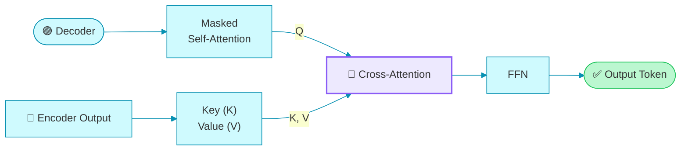
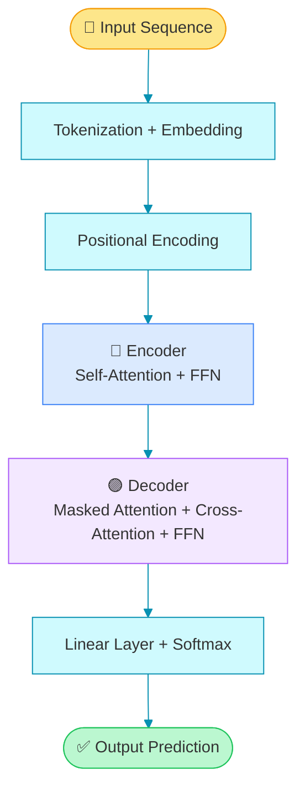
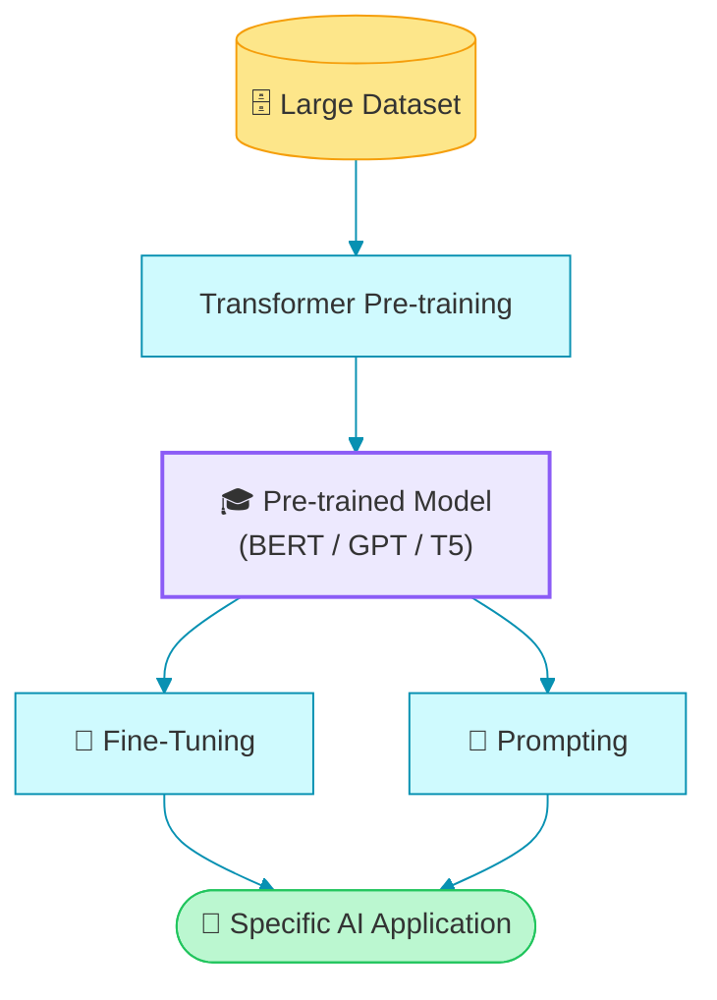
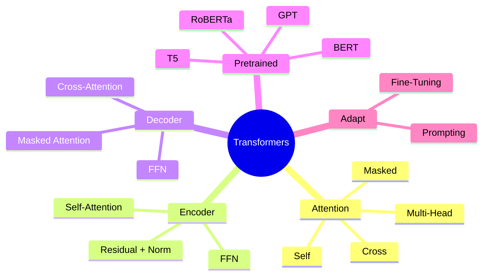

 

  

 

> [!NOTE]
> The sequel to Part 7. This time we open the Transformer's engine: **multi-head attention, residual connections, FFN, cross-attention, masked attention**, and how **pretrained transformers** save us from training LLMs from scratch.

## 🧭 Roadmap

| | | |
|:---:|:---:|:---:|
| **🔍 01** [Self & Multi-Head Attention](#-1-self-attention--multi-head-attention) | **🔗 02** [Residual Connections](#-2-residual-connections) | **🧪 03** [FFN in Encoder](#-3-ffn-in-encoder) |
| **🌉 04** [Cross-Attention](#-4-cross-attention-in-decoder) | **🎭 05** [Masked Attention](#-5-masked-attention-in-decoder) | **🧩 06** [Architecture Summary](#-6-summary-transformer-architecture) |
| **🎓 07** [Pretrained Transformers](#-7-pretrained-transformers) | **🌐 08** [Multiple Platforms](#-8-multiple-platforms) | |

## 🔍 1. Self-Attention & Multi-Head Attention

### 🎯 Single-Head Self-Attention

### 🧠 Multi-Head Attention

> It uses **multiple attention mechanisms in parallel**, so the model can understand **different relationships between words at the same time**.

### 🔀 Each head learns a different view

### 📚 Types of Attention

| 🔵 Self Attention | 🟣 Cross Attention | 🟠 Masked Attention |
|:---:|:---:|:---:|
| Q, K, V from the **same sequence** | Q from **decoder**, K & V from **encoder** | Sees only **current + previous** tokens |

## 🔗 2. Residual Connections

> Instead of passing information only *through* layers, a **residual connection** lets the **original input skip some layers** and be **added to the final output**, preserving the original information.

$$\text{Output} = \text{LayerNorm}\big(x + \text{Sublayer}(x)\big)$$

> [!TIP]
> Residual connections keep the **original signal alive** through deep stacks, which makes deep networks easier to train.

## 🧪 3. FFN in Encoder

| 🎯 Attention | 🔧 Feed-Forward Network (FFN) |
|:---:|:---:|
| **Determines / gathers** the important information | **Transforms** that information to learn **richer features** |

## 🌉 4. Cross-Attention in Decoder

> Cross-attention allows the **decoder** to **access and focus on relevant information from the encoder's output**.

### ⚖️ Self-Attention vs Cross-Attention

| | 🔵 Self-Attention | 🟣 Cross-Attention |
|:---|:---|:---|
| **Q** | Same sequence | From **Decoder** |
| **K** | Same sequence | From **Encoder** |
| **V** | Same sequence | From **Encoder** |

## 🎭 5. Masked Attention in Decoder

> Masked attention ensures the decoder can **only see the current and previously generated tokens, not future tokens.**

### 🤔 How does it work?

Example sentence: **"I love AI today"**

| Query ↓ / Key → | I | love | AI | today |
|:---:|:---:|:---:|:---:|:---:|
| **I** | ✅ | ❌ | ❌ | ❌ |
| **love** | ✅ | ✅ | ❌ | ❌ |
| **AI** | ✅ | ✅ | ✅ | ❌ |
| **today** | ✅ | ✅ | ✅ | ✅ |

### 🧮 The attention mask

$$M = \begin{bmatrix} 0 & -\infty & -\infty & -\infty \\ 0 & 0 & -\infty & -\infty \\ 0 & 0 & 0 & -\infty \\ 0 & 0 & 0 & 0 \end{bmatrix}$$

| Value | Meaning |
|:---:|:---|
| **0** | ✅ Attention **allowed** |
| **−∞** | ⛔ Attention **blocked** |

The mask is added before softmax, so blocked positions become **zero probability**:

$$\text{softmax}\left(\frac{QK^T}{\sqrt{d_k}} + M\right)V$$

### 🆚 Masked Self-Attention vs Cross-Attention

| 🟠 Masked Self-Attention | 🟣 Cross-Attention |
|:---:|:---:|
| Looks at **previous and current tokens** | Looks at the **encoder output** |

## 🧩 6. Summary: Transformer Architecture

  
   
  <i>The Transformer architecture · Source: Wikimedia Commons</i>

 

> [!IMPORTANT]
> ⭐ **GPT** uses a **decoder-only** Transformer architecture.
> ⭐ **BERT** uses **masked language modelling**.

## 🎓 7. Pretrained Transformers

### 😰 Why not build an LLM from scratch?

Building an LLM from scratch is **complex** because it:

| 📚 Needs millions of text samples | ⏳ Takes a lot of time | 💸 Is very expensive |
|:---:|:---:|:---:|

### 💡 Why we need pretrained transformers

| 💰 Reduce cost | ⏱️ Save time | 📉 Need less data | 🚀 Better performance |
|:---:|:---:|:---:|:---:|

> **Definition:** A **pretrained transformer** model has **already been trained on a large amount of data**.

### ⚙️ How does it work?

### 🏛️ Popular Pretrained Transformers

| # | Model | Architecture |
|:---:|:---:|:---:|
| 1 | **BERT** | 🔵 Encoder-only |
| 2 | **GPT** | 🟣 Decoder-only |
| 3 | **T5** *(Text-to-Text Transfer Transformer)* | 🔵🟣 Encoder-Decoder |
| 4 | **RoBERTa** | 🔵 Encoder-only |

### 🔧 Fine-Tuning

> **Fine-tuning** means taking a **pretrained model** and **training it further on a smaller dataset**.

## 🌐 8. Multiple Platforms

> [!NOTE]
> Pretrained transformers are available on many platforms, so you rarely need to start from zero.

| 🤗 Hugging Face Hub | 🔥 PyTorch Hub | 🧠 TensorFlow Hub | ☁️ Cloud AI APIs |
|:---:|:---:|:---:|:---:|
| Thousands of ready models | Pretrained PyTorch models | Reusable TF modules | Hosted LLM services |

## 🗺️ Quick Summary

 

### ✍️ Made with ❤️ by **Sayan Pal**

  

⭐ If these notes helped you, drop a star on the repo and share it with a friend!

